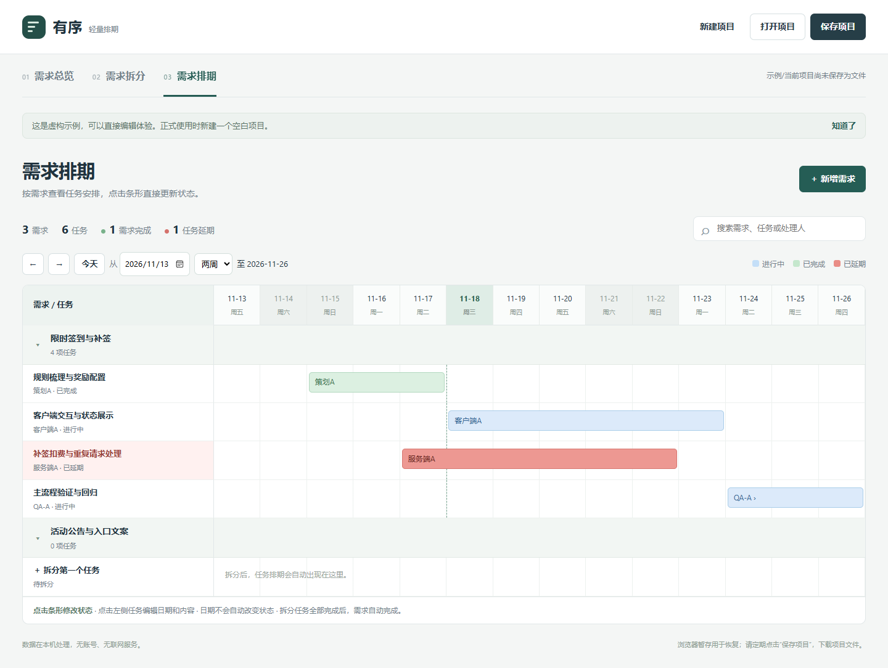

# 有序 · 轻量排期

一个下载后双击 HTML 就能使用的离线需求排期工具。把需求内容、任务拆分和横向排期放在一起，适合个人维护及小团队交接。

**无需安装环境、无需账号、无需启动服务。** 使用原生 HTML、CSS 和 JavaScript，没有第三方运行依赖。



## 开始使用

1. 在本仓库点击 **Code → Download ZIP**，解压整个文件夹；也可以通过 Git 克隆。
2. 用桌面版 Edge 或 Chrome 打开 `index.html`。其旁边的 JS、CSS 文件需要一起保留。
3. 初次打开有虚构示例，可先体验；正式记录时点击“新建项目”。

下载完成后可以断网使用。不要直接在压缩包预览里打开 HTML。

## 三个页面

| 页面 | 可以做什么 |
| --- | --- |
| 需求总览 | 填写需求名字、负责人、预计起止日期和需求内容；正文显示前 60 个字，点击查看全文 |
| 需求拆分 | 自动关联总览需求，新增具体任务，维护优先级、处理人、日期、状态和备注 |
| 需求排期 | 按需求分组，一项任务一条横条；点击横条修改状态，点击左侧任务编辑日期 |

- 浅蓝：进行中；浅绿：已完成；红色：已延期。延期任务在拆分页整行标红。
- 状态由使用者手动设置，日期过期不会自动标为延期。
- 全部拆分任务完成后，需求在总览中变浅绿并沉底，在拆分和排期中隐藏。
- 总览的“查看任务”可以回看、编辑已完成任务；重新打开任务后，需求恢复显示。
- 没有拆分任务的需求不算完成；未填日期的任务仍保留。

## 保存和交接

点击 **保存项目** 下载 JSON 文件，下次通过 **打开项目** 继续编辑。把 JSON 发给同事，对方也可以打开接续处理。

浏览器会尝试暂存编辑内容，但暂存不能替代文件备份；清理浏览器、移动目录或换设备后，可能无法恢复暂存。请确认下载完成并保留最新项目文件。

需求数据只在本机处理，应用不向远端上传内容。此版本没有多人实时协作、合并冲突处理、账号或服务器。请不要把自己的实际项目 JSON 提交到公开仓库。

## 适用范围

适合需要明确“做什么、谁处理、什么时候完成”的轻量排期；可以辅助需求接入、评审后的拆分以及交付跟进。

当前提供三种任务状态和预计日期，不提供工时计算、工作日历、自动依赖排期、拖动改期、基线对比、审批或完整变更历史。需要这些信息时，应以团队原有 PM 系统或确认记录为准。

## 代码与维护

```text
index.html   页面入口
style.css    界面样式
model.js     日期、校验与完成状态计算
app.js       页面交互、暂存与项目文件读写
使用说明.md   详细使用说明
```

修改文件后刷新浏览器即可，没有依赖安装或构建步骤。支持最多 500 条需求、3000 条任务，建议按项目分别保存。

反馈问题时，可以说明操作步骤、预期结果及浏览器版本；如附项目文件，请先删除真实需求和人员信息。
